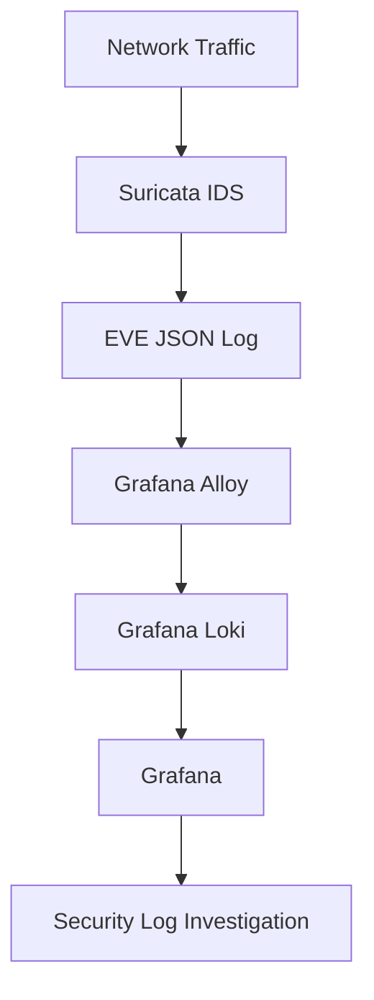

# SOC Architecture

## Overview

This project uses a Raspberry Pi 5 running Debian 13 (Trixie) as a platform for self-hosted security monitoring.

The pipeline collects network security events generated by Suricata, forwards them through Grafana Alloy, stores them in Grafana Loki, and makes them available for investigation in Grafana.

## Architecture Diagram



## Infrastructure

| Component | Technology | Responsibility |
|---|---|---|
| Host | Raspberry Pi 5 | Runs the monitoring services |
| Operating system | Debian 13 (Trixie) | Host operating system |
| Network detection | Suricata 7.0.10 | Generates network security events |
| Log collection | Grafana Alloy | Reads and forwards Suricata logs |
| Log storage | Grafana Loki | Receives and stores log data |
| Visualization | Grafana | Supports log querying and investigation |

## Data Flow

### 1. Network Event Generation

Suricata inspects network traffic and produces structured security events.

**Log source:** `/var/log/suricata/eve.json`

EVE JSON provides event data for security analysis and troubleshooting.

### 2. Log Collection

Grafana Alloy reads the Suricata EVE JSON log and forwards collected entries to Loki.

**Configuration:** `/opt/soc/alloy/config.alloy`

During development, the Alloy configuration required troubleshooting to ensure the log file was read directly rather than relying on the earlier file-discovery approach.

### 3. Log Storage

Grafana Loki receives forwarded log entries and makes them available for querying.

**Configuration:** `/opt/soc/loki/loki-config.yml`

### 4. Investigation and Visualization

Grafana connects to Loki to explore collected log data.

This pipeline provides the foundation for security-focused queries, dashboards, and future alerting workflows.

## Deployment Organization

The SOC deployment is organized under `/opt/soc` on the host.

```text
/opt/soc/
├── compose.yml
├── alloy/
│   └── config.alloy
├── loki/
│   ├── loki-config.yml
│   └── data/
└── grafana/
    └── data/
```

This is a simplified representation of the known deployment paths, not a complete listing of every file on the host.

## Current Status

- [x] Core SOC services deployed.
- [x] Suricata EVE JSON log collection configured.
- [x] Alloy forwards Suricata logs to Loki.
- [x] End-to-end log pipeline operational.
- [ ] Create dedicated security investigation dashboards.
- [ ] Develop reusable LogQL queries.
- [ ] Add and validate security alerting rules.
- [ ] Integrate selected host authentication and system logs.
- [ ] Document controlled test events and investigations.

The unchecked items are planned improvements, not completed features.

## Security Considerations

This repository documents a personal cybersecurity lab for defensive monitoring and authorized testing.

Before publishing configuration files, logs, screenshots, or diagrams:

- Remove passwords, API keys, authentication tokens, and other secrets.
- Replace private network addresses and device-specific identifiers where appropriate.
- Remove personal information and sensitive network details.
- Never commit credentials, private keys, or unredacted environment files.
- Review exposed ports and service bindings before publishing deployment configurations.

## Lessons Learned

The project involved troubleshooting the Alloy log-collection configuration to ensure Suricata EVE JSON entries could be forwarded into Loki.

Additional implementation notes, root-cause analysis, and validation results will be documented as the project develops.

## Roadmap

- [x] Establish the Suricata-to-Alloy-to-Loki-to-Grafana pipeline.
- [ ] Document deployment and configuration in reproducible detail.
- [ ] Create reusable LogQL investigation queries.
- [ ] Build security-focused Grafana dashboards.
- [ ] Implement and test meaningful alerting.
- [ ] Integrate additional host and authentication logs.
- [ ] Document controlled detection tests and investigation workflows.
- [ ] Publish sanitized screenshots and example findings.
